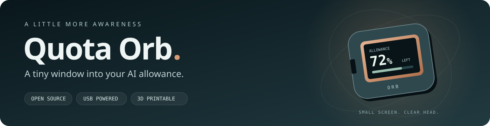
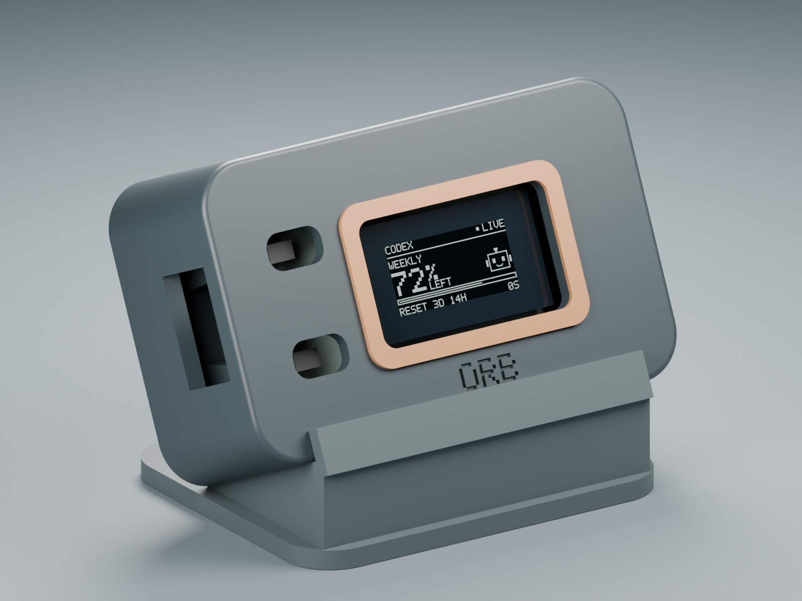
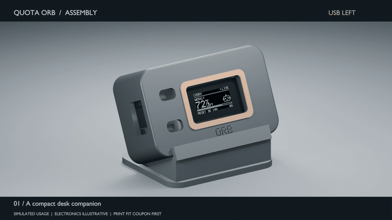
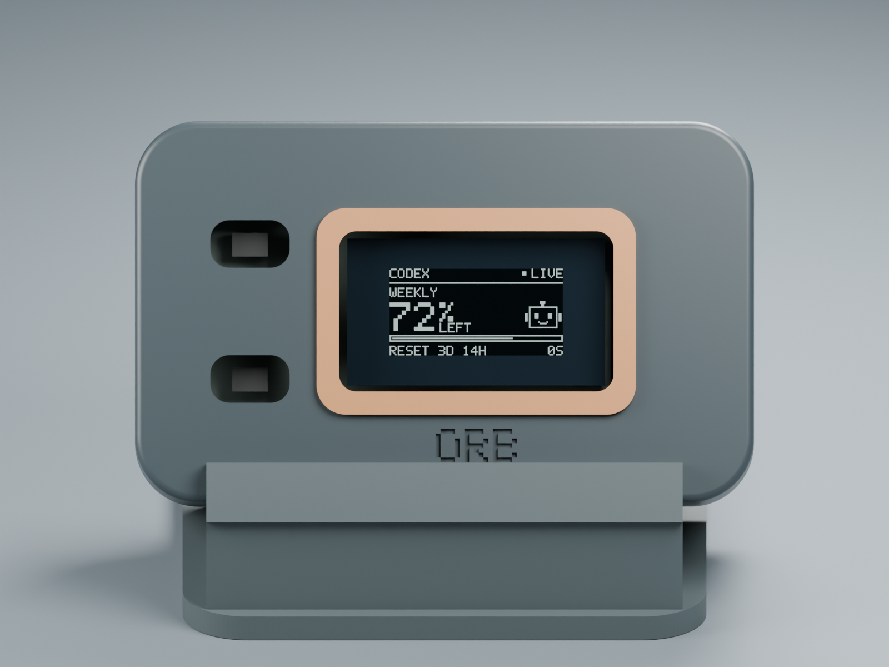
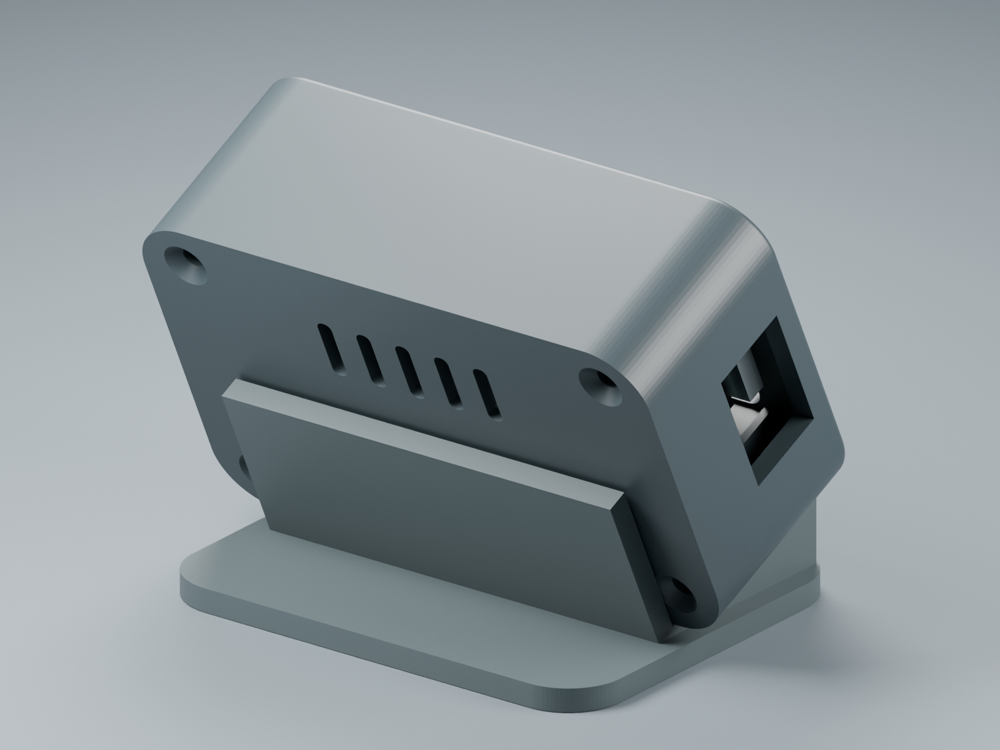
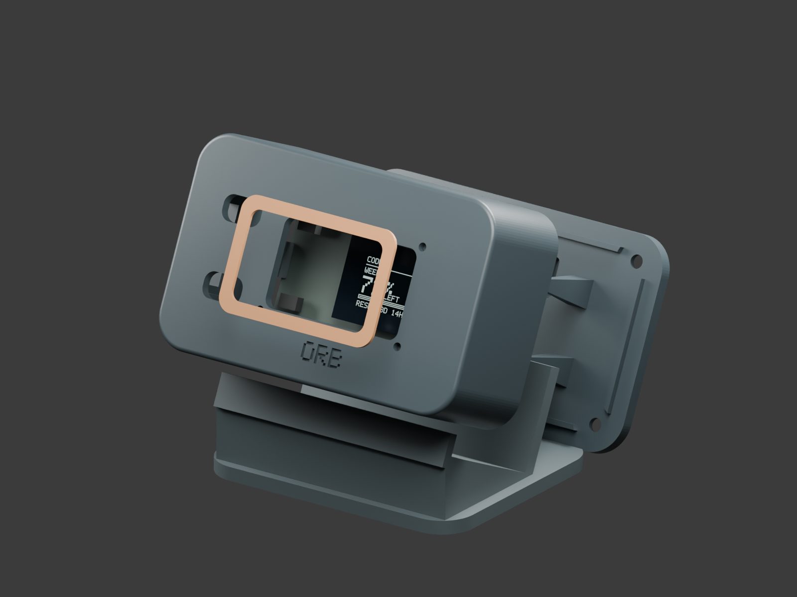
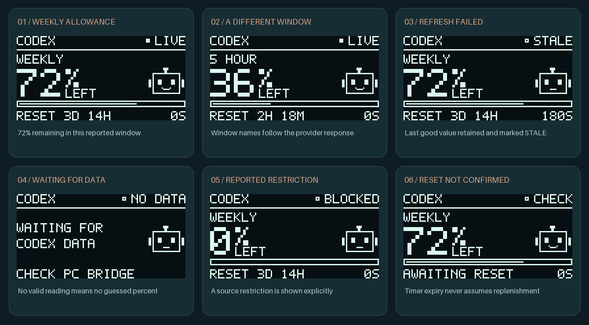

<div align="center">



### Your AI allowance. A tiny screen. A calmer desk.

**A USB-powered desk companion you can build, print, and make your own.**

[Build one](docs/SETUP.md) &nbsp; · &nbsp; [Print one](enclosure/README.md) &nbsp; · &nbsp; [Watch it assemble](enclosure/preview/Quota-Orb-Enclosure-Assembly.mp4) &nbsp; · &nbsp; [Explore the internals](docs/ARCHITECTURE.md)



</div>

Quota Orb puts remaining AI allowance, reset time, and data freshness on a 0.96-inch OLED. The **Codex** integration reads subscription limits through its documented local app-server. An experimental **Claude Code** adapter receives documented local quota events. A small Windows bridge handles the account read; the ESP32 receives only display pixels over USB.

**Open source, no cloud backend, no WiFi setup, no credentials on the board.** Provider availability is explicit: Codex polling, experimental Claude Code events, and Gemini unavailable pending a verified quota adapter. This is an independent community project, unaffiliated with OpenAI or Heltec.

<table>
<tr>
<td width="33%"><strong>GLANCE</strong><br/>Remaining allowance, reset time, and freshness. Readable in a moment.</td>
<td width="33%"><strong>TRUST</strong><br/>Visible stale and offline states. Failed reads never become invented numbers.</td>
<td width="33%"><strong>MAKE</strong><br/>A small ESP32 board, one USB cable, and a case you can print.</td>
</tr>
</table>

## See it come together



[Download the full 1080p assembly video](enclosure/preview/Quota-Orb-Enclosure-Assembly.mp4). The printed parts are rendered from the exported CAD meshes; electronics are explanatory models. Every showcased usage value is synthetic.

<details>
<summary><strong>Explore the enclosure from every angle</strong></summary>

| From the front | Serviceable from the rear |
|:---:|:---:|
|  |  |



</details>

## What to expect on your desk



The gallery uses the **actual framebuffer renderer**, enlarged without smoothing. These are examples of the output, not account screenshots.

| When… | Quota Orb shows… |
|---|---|
| A recent read succeeds | Remaining percentage, a remaining-allowance bar, reset countdown, and age |
| More than one window is reported | A PRG tap cycles the available windows |
| A refresh fails | The last good percentage, marked **STALE**, with its age increasing |
| The host stops sending frames | **USB OFFLINE** after six seconds |
| A reset time passes | **AWAITING RESET** until a successful read confirms the new allowance |

**Codex: 60-second source reads · Claude: local events · OLED: 1-second redraws.** Provider reporting can lag; the device does not count individual tokens or calculate spending.

## What it does

- Shows remaining allowance and the reset countdown for the reported quota windows.
- Polls Codex limits every **60 seconds**, or follows Claude events; redraws every second.
- Keeps the last successful value marked **STALE** when refresh fails; never guesses a quota reset.
- Marks the display **USB OFFLINE** when the host stops sending frames.
- Uses the board's PRG button to switch windows, adjust brightness, or flip the display.
- Includes six printable parts, a fit coupon, editable STEP solids, and a 3MF print plate.

Allowance is **not** a token counter, spending estimate, or per-token live stream. Upstream reporting may lag.

## Hardware

| Item | Requirement |
|---|---|
| Board | Heltec WiFi Kit 32 **V2**, ESP32, 0.96-inch 128×64 OLED |
| Connection | Micro USB **data** cable to a Windows PC |
| Account | Eligible provider subscription connected through its official CLI |
| Printing | PLA, 0.4 mm nozzle; optional enclosure |

V3/S3 boards use different pins and require a separate firmware target. API-key-only sign-in does not provide subscription allowance.

## From download to desk

**Download → Run → Choose provider → Sign in officially → Verify quota → Connect USB → Start.**

Install **Python 3.10+ with Tcl/Tk** on Windows, extract this repository, then double-click:

```text
Run Quota Orb.cmd
```

The launcher prepares a local Python environment and opens a four-step desktop wizard. **Preview demo** works immediately without an account or board. **Install provider CLI** opens the official instructions. If already signed into that CLI, **Check connection** reuses it; otherwise **Sign in with provider** opens the vendor-owned browser flow. No token, password, cookie, or API key is pasted into Quota Orb.

| In the wizard | What happens |
|---|---|
| **1 · Choose provider** | Capability is explicit: Codex available, Claude experimental, Gemini unavailable |
| **2 · Connect account** | Official sign-in when needed, then a real quota-access check |
| **3 · Connect Heltec** | Find the USB board and verify firmware/OLED; install firmware if required |
| **4 · Start monitor** | Launch the background bridge and watch acknowledged frames increase |

**[Follow the complete setup guide →](docs/SETUP.md)** — every button, provider limitations, firmware backup/upload, troubleshooting, and where sensitive data stays.

Codex uses `codex login`. Claude uses `claude auth login` plus an explicitly enabled local status line. Quota Orb never handles provider credentials. Claude quota events depend on an eligible active session; they are not continuous polling. Gemini cannot be connected in this release. A browser chat login alone does not establish a local CLI connection.

The firmware installer requires confirmation, verifies an **8 MB classic ESP32**, and saves a complete **private flash backup** before upload. The supported hardware is specifically **Heltec WiFi Kit 32 V2**. Firmware replacement is never automatic on app launch.

## A case you can make

The rounded enclosure has a copper-colour accent, a removable rear cover, a slide-in desk stand, and **USB on the left when facing the screen**. Nominal assembly size: **78 × 54 × 60.1 mm**. It allows headers projecting up to 15 mm below the PCB.

**Print the [fit coupon](enclosure/output/stl/05-fit-coupon.stl) first.** The enclosure is a CAD/slicer-checked prototype. A physical enclosure has not been printed or fit-tested. OLED, button, and cable alignment must be checked against the actual board.

| Get | Use |
|---|---|
| [STL parts](enclosure/output/stl) | Individual parts in print orientation, millimetres |
| [3MF plate](enclosure/output/Quota-Orb-Enclosure-RevA.3mf) | Six separate objects arranged for a 180 mm bed |
| [STEP assembly](enclosure/output/Quota-Orb-Enclosure-RevA.step) | Edit mechanical solids in CAD |
| [Print and assembly guide](enclosure/README.md) | Settings, fasteners, orientation, fit checks |

## Validation and limits

Local validation passed 27 checks covering parsing, freshness, rendering, transport, failure recovery, credential-free login dispatch, event sanitization, and settings preservation. The original hardware prototype passed USB acknowledgement, CRC rejection, parser recovery, watchdog and reconnect checks. The physical OLED was checked as readable and upright.

The enclosure builder asserts valid solids, manifold meshes, nominal PCB/header/fastener clearances, and left-side USB access. The print plate has been sliced with supports disabled. These checks do not prove physical fit, thermal performance, or cable stability. See [verification scope](docs/VERIFICATION.md).

The public tree is focused on running, flashing, and maintaining this target. Reproducible project tests are versioned for contributors and CI. Development generators, hardware-validation tools, audit/packaging scripts, and working scenes remain in an ignored local `tooling/` folder. CI runs bridge tests on Windows and builds the firmware.

## Privacy by design

For Codex, the bridge asks the local app-server only for initialization and account rate limits. For Claude, it retains only numeric quota fields from documented local status-line events. It does not open credential files, start AI turns, or read conversations. The board receives a 1,024-byte framebuffer plus framing/CRC. The desktop wizard uses no local web server. No remote backend or telemetry endpoint is included.

Running the bridge creates **local** aggregate usage previews and logs. They are ignored by Git. Review any diagnostic material before sharing it. Public visuals and test fixtures contain simulated data. See [privacy](docs/PRIVACY.md) and [security reporting](SECURITY.md).

## Contribute

Useful next steps are physical enclosure fit reports, supported provider adapters, and tested ports to other boards or operating systems. Include board revision, measured dimensions, and reproducible steps; omit account details and raw logs. Read [CONTRIBUTING.md](CONTRIBUTING.md).

PRs need a clear `type: description` title, completed purpose/implementation/validation sections, test evidence, passing CI, and review. New code dismisses stale approvals; review conversations must be resolved. See the [community standards](CODE_OF_CONDUCT.md).

Code, original CAD, and original artwork are available under the [MIT license](LICENSE). Dependency and manufacturer trademarks remain with their respective owners.

Inspired by [ClaudeGauge](https://www.hackster.io/dorofino/claudegauge-real-time-ai-usage-monitor-on-esp32-s3-with-a-a82d4b). Built using the [documented Codex app-server](https://learn.chatgpt.com/docs/app-server), [Heltec V2 pinout](https://resource.heltec.cn/download/WiFi_Kit_32/WIFI_Kit_32_pinoutDiagram_V2.pdf), and [PlatformIO board target](https://docs.platformio.org/en/latest/boards/espressif32/heltec_wifi_kit_32.html).
